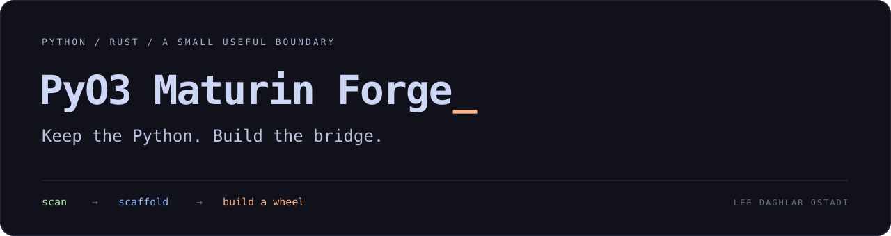

<p align="center">
  
</p>

<p align="center">
  <a href="#start">Start</a> · <a href="#what-gets-generated">Generated project</a> ·
  <a href="#commands">Commands</a> · <a href="#verification">Verification</a> ·
  <a href="LICENSE">MIT</a>
</p>

**Keep the Python. Build the bridge.**

I want to keep an existing Python codebase usable while giving it a small Rust
boundary. Forge inspects imports, writes a mixed Python/Rust project, and lets
maturin build the wheel. The generated PyO3 module can check imports, run Python
modules, and call Python functions. Your Python source remains Python.

The Forge CLI uses only Rust's standard library. The generated bridge depends
on PyO3; building its wheel requires Python, Rust, and maturin.

## Start

```sh
git clone https://github.com/lostadi/pyo3-maturin-forge.git
cd pyo3-maturin-forge
cargo build --release --locked
./forge.sh help
```

`forge.sh` builds the release executable if it is missing and forwards the
arguments. You can also install the CLI with `cargo install --path . --locked`
or invoke `target/release/pyo3-maturin-forge` directly.

Point Forge at the Python project you want to package:

```sh
./forge.sh scan --root /path/to/python-project
./forge.sh init --root /path/to/python-project --package my_bridge --copy-python
```

The default output is `/path/to/python-project/.pyo3-forge`. `--forge-dir NAME`
selects another directory relative to the project; an absolute path is used
as given. Running `init` again rewrites the generated files, and `--copy-python`
replaces the generated payload. Keep edits to the generated bridge under your
own version control before regenerating it.

Use an environment with maturin installed to build the wheel:

```sh
python3 -m venv /path/to/build-venv
/path/to/build-venv/bin/python -m pip install maturin

./forge.sh build --root /path/to/python-project \
  --python /path/to/build-venv/bin/python
```

The wheel is written under `.pyo3-forge/target/wheels/`. Install the resulting
wheel with pip. `develop` is the alternative for installing into an active
virtual environment during development.

## What gets generated

```text
.pyo3-forge/
├── Cargo.toml                     PyO3 native-extension crate
├── pyproject.toml                 maturin and Python package configuration
├── src/lib.rs                     import / run / call bridge
└── python/my_bridge/
    ├── __init__.py
    ├── runner.py                  helpers for the copied source
    ├── py.typed
    └── payload/                   optional .py source snapshot
```

```python
import my_bridge as forge

print(forge.import_check(["json", "torch"]))
forge.run_payload_module("your_module", args=["--example"])
print(forge.call_payload_object("your_module:handle", args=["hello"]))
```

`call_payload_object` passes one list of strings to the selected Python
function and returns the string produced by `repr(result)`. The lower-level
`run_module` and `call_object` functions accept an optional source directory.
These helpers execute Python inside the current interpreter and can change
`sys.path` and `sys.argv`.

`--copy-python` copies regular `.py` files, preserving their relative paths.
It skips common environment/build directories and symbolic links. Assets,
native libraries, data files, and dependency declarations are not inferred;
add those to the generated package configuration yourself.

## Commands

| Command | What it does |
| --- | --- |
| `scan` | Lists static import roots and reports recognized heavy imports at column zero. |
| `init` | Writes the mixed project and optionally copies Python source. |
| `deps` | Installs build tools, then selected Python distributions; selected dependencies use wheels only by default. |
| `build` | Runs `python -m maturin build`, with `--release` unless `--debug` is supplied. |
| `develop` | Runs `python -m maturin develop` for the generated project. |
| `check` | Emits a JSON import report through the selected Python interpreter. |
| `doctor` | Prints tool versions and the import scan. |

For selected dependencies:

```sh
./forge.sh deps --root /path/to/python-project \
  --python /path/to/build-venv/bin/python \
  --module transformers --module tokenizers

./forge.sh check --root /path/to/python-project \
  --python /path/to/build-venv/bin/python \
  --module transformers --module tokenizers
```

`deps` uses distribution names; `check` uses import names. For example,
`huggingface-hub` installs the distribution and `huggingface_hub` imports it.
`--requirements FILE` adds recognized heavy dependencies from that file to
`deps`; it is not a full requirements-file resolver. `--allow-source` permits
source builds for the selected dependencies.

## Boundaries

Forge creates a packaging scaffold. It does not translate Python into Rust,
remove the Python runtime, accelerate existing functions, or bundle a complete
ML environment. Native extensions such as Torch remain ordinary Python
dependencies with their own platform requirements.

The import scan is line-based, not a Python AST analysis. Dynamic imports,
multiline syntax, and text inside strings can escape or confuse it. Treat the
report as a starting point. `check` reports failed imports in JSON but currently
exits successfully if its Python reporting process ran; inspect the `ok` fields.

The generated project declares Python 3.9+, but the published verification below
does not establish compatibility with every Python, OS, or dependency version.

## Verification

```sh
cargo test --locked
cargo build --release --locked
python3 tests/smoke.py target/release/pyo3-maturin-forge
# With maturin installed: build, install, and exercise a real fixture wheel.
python3 tests/smoke.py target/release/pyo3-maturin-forge --wheel
```

The smoke test uses disposable Python sources. It checks output placement,
source copying, symlink exclusion, and the import report. Its optional wheel
path builds the generated native bridge, installs it into a temporary virtual
environment, and exercises import checking, a payload function, and a payload
module. It does not install or qualify Torch or the Hugging Face stack.

The initial publication was verified on Apple Silicon with Rust 1.97.1,
Python 3.15.0, maturin 1.15.0, and the generated PyO3 dependency resolved to
0.29.3. See [Actions](https://github.com/lostadi/pyo3-maturin-forge/actions)
for the separate CI result.

---

Built by **[Lee Daghlar Ostadi](https://leeostadi.com)**. [MIT licensed](LICENSE).
